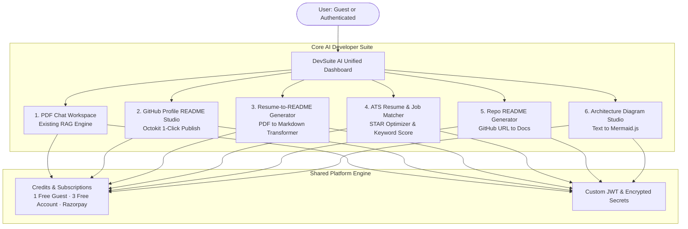

# 🚀 DevSuite AI: Multi-Tool AI Developer & Career Platform
## Architectural Master Plan & Implementation Roadmap

---

## 1. Executive Summary & Vision

This plan details the architectural evolution of the existing **AI PDF Chat App** into **DevSuite AI** — a comprehensive, multi-tool developer intelligence and career acceleration platform. 

### Core Product Thesis
Developers, computer science students, and tech professionals frequently switch between fragmented tools to:
1. Digest technical documentation and research papers (PDF Chat).
2. Showcase their open-source identity and skills (GitHub Profile README).
3. Convert their traditional resume into modern developer portfolio formats (Resume-to-README).
4. Optimize resumes against technical job descriptions (ATS Matcher).
5. Generate software architecture diagrams (Mermaid.js Studio).

By unifying these tools under a **shared custom JWT authentication**, **consistent dark-mode design system**, and a **centralized credit/payment engine** (Razorpay), DevSuite AI drives higher customer retention, viral organic acquisition via GitHub profile badges, and greater credit utilization.

---

## 2. Architectural Principles & Non-Negotiables

| Principle | Specification |
| :--- | :--- |
| **Authentication Integrity** | Retain custom JWT Authentication (`Authorization: Bearer <token>`). No replacement with third-party auth services. |
| **GitHub Token Security** | GitHub Personal Access Tokens (PAT) and OAuth tokens are AES-256 encrypted in MongoDB (`crypto`). Tokens are never sent to the client browser. |
| **Backward Compatibility** | Existing `/app` route, document library, IndexedDB PDF caching, and chat history remain 100% operational. |
| **Unified Credit Engine** | Single source of truth for credits across all tools (1 Guest Credit → 3 Free Signup Credits → Pay-per-credit or Pro Subscription). |
| **Design System Consistency** | Dark/light slate palette, glassmorphism, Lucide icons, responsive dual-pane split views, Tailwind CSS styling. |

---

## 3. Product Tool Suite Overview



---

## 4. Detailed Feature Specifications

### 🛠️ Tool 1: PDF Chat Workspace (`/dashboard/chat-pdf` or `/app`)
* **Status**: Core feature built and verified.
* **Capabilities**:
  - Drag-and-drop PDF upload (up to 500 pages for Pro, 25 for Free).
  - LangChain + Gemini 2.5 Flash streaming answers with page-level citations.
  - Interactive split-screen PDF document viewer with citation jumping.
  - Permanent document library with IndexedDB offline caching.
* **Credit Cost**: 1 Credit per uploaded document (Unlimited for Pro).

---

### 🐙 Tool 2: GitHub Profile README Studio (`/dashboard/github-studio`)
* **Status**: High Priority (Phase 1).
* **Capabilities**:
  - **Left Pane (Interactive Builder Form)**:
    - Personal info: Name, Professional Title, Bio, Location.
    - Social badges: LinkedIn, Twitter/X, Portfolio, Email, YouTube.
    - Tech Stack Badges: Multi-select categorized badges (Languages, Frontend, Backend, Databases, Cloud & DevOps).
    - Featured Projects: Dynamic project cards (Title, Description, Tech Stack, Repo URL, Live Demo).
    - GitHub Stats Widgets: Overall Stats Card, Top Languages, Streak Stats, Contributions.
  - **Right Pane (Live Preview)**:
    - Real-time rendered Markdown view using `react-markdown` and `remark-gfm`.
    - Tab toggle to raw Markdown source code with 1-click copy.
  - **1-Click GitHub Publish Action**:
    - Automatically targets `username/username` special repository.
    - If repository does not exist, automatically creates it public via GitHub REST API.
    - Checks file SHA and commits/updates `README.md`.
    - Viral badge embedded: `Made with DevSuite AI`.
* **Credit Cost**: Free to design / 1 Credit or Pro to auto-publish.

---

### 📑 Tool 3: Cross-Tool "Resume-to-README" (`/dashboard/resume-to-readme`)
* **Status**: High Priority (Phase 1).
* **Capabilities**:
  - Select any already-uploaded Resume PDF from the user's document library (or upload a new resume).
  - Gemini 2.5 Flash extracts:
    - Tech skills and proficiencies.
    - Work experience and notable achievements.
    - Open-source projects and repositories.
  - Automatically synthesizes and populates the **GitHub Profile Studio**, converting a resume into a GitHub Profile README in under 5 seconds.
* **Credit Cost**: 1 Credit per resume synthesis.

---

### 🎯 Tool 4: AI ATS Resume Optimizer & Job Matcher (`/dashboard/ats-matcher`)
* **Status**: Phase 2 Priority.
* **Capabilities**:
  - Select Resume PDF + paste Target Job Description (JD).
  - Analysis Output:
    - **ATS Match Score (0–100%)**.
    - **Missing Critical Keywords & Technologies** (e.g., "Kubernetes", "Redis").
    - **Bullet-Point Rewrite Suggestions** using Google STAR method (*Situation, Task, Action, Result*).
    - Hard skills vs. Soft skills breakdown chart.
* **Credit Cost**: 1 Credit per scan.

---

### 📦 Tool 5: GitHub Repo to README Generator (`/dashboard/repo-docs`)
* **Status**: Phase 2 Priority.
* **Capabilities**:
  - Paste any GitHub repository URL (or pick from linked repositories).
  - Backend inspects project file tree, `package.json` / `go.mod` / `requirements.txt`, and entry points.
  - Gemini generates a complete `README.md`:
    - Project Architecture flowchart (Mermaid.js).
    - Prerequisites, installation instructions, environment variables table.
    - API endpoints or usage examples.
* **Credit Cost**: 1 Credit per generated repository README.

---

### 📐 Tool 6: Architecture Diagram Studio (`/dashboard/diagrams`)
* **Status**: Phase 3 Priority.
* **Capabilities**:
  - Plain English prompt: *"Create an architecture diagram for an e-commerce platform with Next.js, API Gateway, Auth service, Stripe payments, and Kafka event streaming."*
  - Generates Mermaid.js sequence or flowchart code.
  - Live interactive rendering on canvas with theme switcher (Dark, Midnight, Forest).
  - Export to SVG / PNG / Markdown snippet.
* **Credit Cost**: Free basic / 1 Credit complex.

---

## 5. Security & Data Architecture

```
Client Browser (React)
    │
    │  Authorization: Bearer <JWT>
    ▼
Backend Gateway (Express / JWT Middleware)
    │
    ├── 1. Validates JWT Signature & extracts req.userId
    ├── 2. Queries MongoDB collections.users().findOne({ _id: userId })
    │
    ├── 3. Decrypts stored GitHub Token using AES-256 (Server Secret)
    ▼
Octokit Engine (@octokit/rest)
    │
    ├── GET /repos/:username/:username  (Verify profile repo)
    ├── POST /user/repos                 (Auto-create if 404)
    └── PUT /repos/:username/:username/contents/README.md  (Commit Base64)
```

### Encryption Specification
- **Algorithm**: `aes-256-cbc`
- **Key Derivation**: SHA-256 hash of server `JWT_SECRET` (32 bytes).
- **Storage Format**: `ivHex:encryptedHex` in `users.githubToken`.
- **Decryption Rule**: Token is only ever decrypted in RAM within `githubService.js` and immediately garbage-collected after the Octokit request completes.

---

## 6. Implementation Milestones

### Phase 1: Core Multi-Tool Shell & GitHub Studio (Completed)
- [x] **Task 1.1**: Install `@octokit/rest` and implement `backend/src/services/githubService.js`.
- [x] **Task 1.2**: Implement `backend/src/routes/github.routes.js` with routes:
  - `GET /api/github/status`
  - `POST /api/github/connect-token`
  - `POST /api/github/disconnect`
  - `POST /api/github/commit-readme`
- [x] **Task 1.3**: Build frontend hook `useGithubIntegration.js`.
- [x] **Task 1.4**: Build collapsible `Sidebar.jsx` and Dashboard layout wrapper (`/dashboard/*`).
- [x] **Task 1.5**: Implement dual-pane `GithubStudio.jsx` with tech badges, live markdown render, and 1-click publish modal.
- [x] **Task 1.6**: Implement "Resume-to-README" endpoint leveraging existing LangChain/Gemini prompt pipeline & frontend page `ResumeToReadme.jsx`.

### Phase 2: Career Intelligence & Repository Tools (Completed)
- [x] **Task 2.1**: Implement ATS Resume Matcher (`/api/career/ats-scan`).
- [x] **Task 2.2**: Build ATS Matcher UI (`AtsMatcher.jsx`) with score gauges and STAR bullet recommendations.
- [x] **Task 2.3**: Build GitHub Repo README generator (`/api/github/generate-repo-readme`) and frontend studio (`RepoDocsPage.jsx`).
- [x] **Task 2.4**: Connect user linked repositories picker & 1-click commit back to GitHub.

### Phase 3: Visual Productivity Tools & Launch Polish (Completed)
- [x] **Task 3.1**: Integrate Mermaid.js canvas for text-to-diagram generation (`DiagramStudio.jsx` & `/api/career/generate-diagram`).
- [x] **Task 3.2**: Add viral badges to generated READMEs linking back to DevSuite AI.
- [x] **Task 3.3**: Final end-to-end integration, routing, sidebar navigation, and Landing Page multi-tool showcase updates.

---

## 7. Credit & Monetization Mapping

| Action | Free Tier (Guest) | Free Tier (Registered) | Pro Member (₹299/mo) |
| :--- | :---: | :---: | :---: |
| **PDF Chat & Indexing** | 1 Document Trial | Deducts 1 Credit (starts with 3) | **Unlimited** |
| **GitHub README Studio Builder** | Unlimited Previews | Unlimited Previews | **Unlimited Previews** |
| **Publish README to GitHub** | Sign-up Required | Deducts 1 Credit | **Unlimited 1-Click Commits** |
| **Resume-to-README Synthesis** | Sign-up Required | Deducts 1 Credit | **Unlimited** |
| **ATS Resume Job Match Scan** | Sign-up Required | Deducts 1 Credit | **Unlimited** |
| **Architecture Diagram Export** | Unlimited Watermarked | Unlimited | **High-Res SVG/PNG** |
